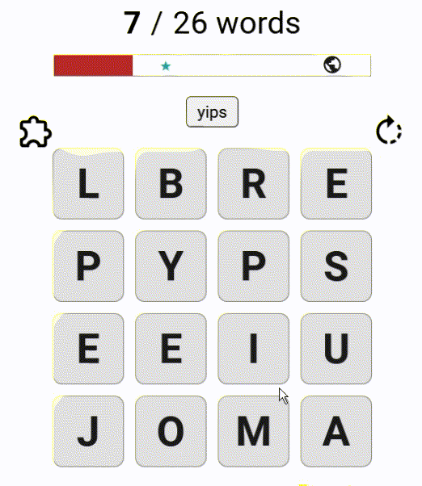
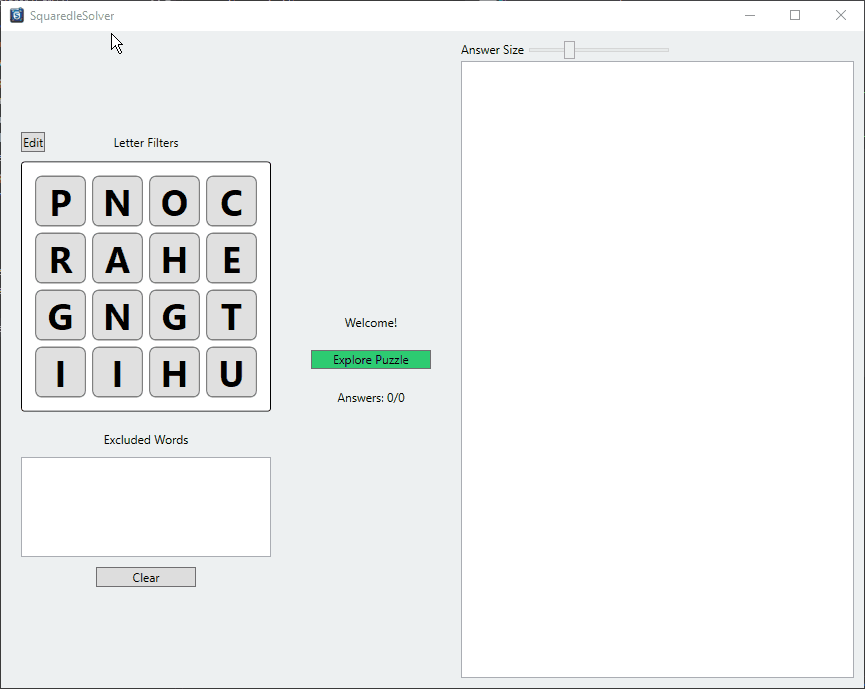

### Squaredle Solver

[Squaredle](https://squaredle.app/) is a word search puzzle where you find words by drawing a path through a small grid of letters.

Once you've found all the words that use a particular grid cell, that cell gets faded out.

It turns out I actually find the game quite frustrating and I thought I would have more fun writing a solver for it than actually playing the game as intended.

[Link to the source code](https://github.com/SamuelSalam815/SquaredleSolver)

#### How the solver is meant to be used

It's all well and good showing all the solutions at once, but usually this is too much information at once - and rarely is someone keen to cheat before finding even a single word. We need to filter down the solutions to a useful set.

The first filter is the 'used cell' filter. This lets you match the solver to your current puzzle state. This eliminates the vast majority of words you've already found. The second filter is the 'individual word' filter. Clicking on individual patterns in the solution viewer will mark it as 'found' and add the corresponding word to the exclusion list.

#### The search algorithm

The game can be viewed as finding non-repeating paths through a graph. 

The fact that valid paths can vary in length actually adds many more possible solutions. I encountered a problem with the search space in my initial implementation. 

With hindsight, I wish I had benchmarked it.

The key insight is that the number of valid words is far smaller than the search space of possible paths through the graph. 

The approach that I settled on as 'fast enough' precomputes a dictionary of prefixes to all valid words. This prefix dictionary prunes paths while performing an exhaustive depth-first traversal - in other words, at each step I check if the current sequence is a valid start to a word. This check ends up being just a dictionary look up. 